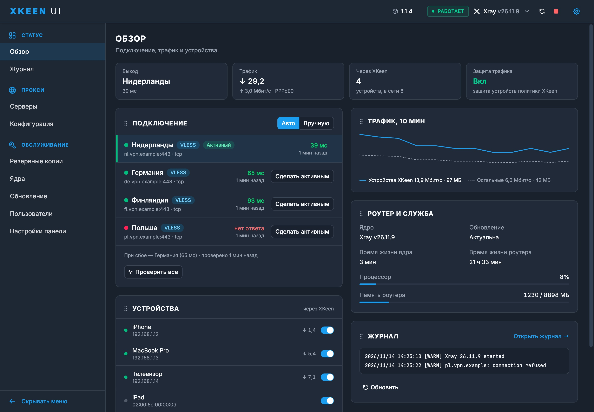

<div align="center">
  

<h1>XKeen UI</h1>

<p>
  Удобная веб-панель для <b>XKeen</b> на роутерах Keenetic.<br>
  Видно, через какой сервер идёт трафик, какие устройства ходят через VPN и всё ли в порядке, —<br>
  и всё это можно поменять из браузера, без SSH и ручной правки JSON.
</p>

<p>
  <a href="docs/guide.md">Руководство</a> ·
  <a href="docs/xray-servers.md">Серверы Xray</a> ·
  <a href="docs/faq.md">FAQ</a> ·
  <a href="https://github.com/nvorobev/XKeenUI/releases">Релизы</a>
</p>



<sub>Главная страница. Данные на скриншоте демонстрационные.</sub>

</div>

## Зачем это нужно

XKeen отлично работает, но управлять им приходится через SSH: открыть конфиг, поправить JSON, не ошибиться в запятой, перезапустить и надеяться, что всё поднимется. XKeen UI делает то же самое через понятный интерфейс: показывает, что происходит прямо сейчас, проверяет изменения до применения и откатывает их, если ядро не запустилось.

## Что умеет

### Главная — всё важное на одном экране

Четыре плитки сверху отвечают на главные вопросы: через какой сервер вы выходите в интернет и с какой задержкой, какая сейчас скорость, сколько устройств ходит через XKeen и включена ли защита трафика. Ниже — карточки, которые можно расставить как удобно: перетащите за значок ⋮⋮, порядок запомнится.

> **Пример.** Вечером тормозит видео. На главной видно, что «Нидерланды» отвечают за 300 мс, а «Германия» — за 60. Выбираете «Германия» в списке — Xray перезапускается, через пару секунд видео идёт дальше.

### Серверы и автопереключение

Все серверы — из ваших конфигов и добавленные по ссылке (`vless://`, `vmess://`, `trojan://`, `ss://`, `hysteria2://`) — в одном списке с задержкой и состоянием. Отметьте галочкой несколько серверов, и они станут пулом: панель регулярно их проверяет и, если текущий перестал отвечать, сама переключается на самый быстрый из живых.

> **Пример.** Ночью у основного сервера упал хостинг. Утром вы даже не заметите — панель после трёх неудачных проверок подряд перевела трафик на запасной, а в журнале осталась запись, когда и почему.

На главной этим можно управлять не заходя в раздел: выбрать сервер, переключить режим «Авто / Вручную», нажать «Проверить все».

### Устройства — кто ходит через VPN

Список устройств из Keenetic: кто в сети, кто сколько качает, и переключатель «через XKeen» у каждого. Переключатель делает то же, что «Применение политик» в веб-интерфейсе роутера: добавляет устройство в политику доступа XKeen или убирает из неё.

> **Пример.** Телевизор и ноутбук — через VPN, приставка — напрямую, чтобы не росла задержка в онлайн-играх. Два щелчка, без поиска MAC-адресов в настройках роутера.

### Защита трафика — без утечек мимо прокси

Если XKeen остановлен, ядро упало или роутер ещё загружается, устройства из политики XKeen по умолчанию выходят в интернет напрямую — с вашим реальным IP. Опция **Настройки → Защита трафика → «Блокировать трафик мимо прокси»** ставит правило, которое в такой момент просто не выпускает их трафик на проксируемых портах. Пока прокси работает, правило ничего не блокирует.

> **Пример.** Обновляете ядро Xray, и XKeen на минуту останавливается. Без защиты телевизор за эту минуту успеет сходить на сайты напрямую; с защитой он подождёт, пока прокси снова заработает.

Остальные порты, устройства вне политики, локальная сеть и адреса из исключений XKeen не затрагиваются.

В настройках доступен отдельный режим **«Весь интернет только при доступном VPN»**. Он проверяет HTTPS/HTTP-соединение через выбранный VPN и при неудаче блокирует весь интернет устройств политики XKeen, включая `direct`, любые порты и IPv6. Локальная сеть и доступ к панели сохраняются; публичные исключения XKeen в этом режиме не обходят блокировку. Для Xray проверяется активный сервер пула или текущее самостоятельное подключение. Для Mihomo нужно выбрать сервер или группу в поле «Проверяемый VPN»; выбор `DIRECT` не считается доступным VPN.

Проверки выполняются каждые 5 секунд после завершения предыдущей (таймаут запроса — до 5 секунд, запуск проверки Xray — дополнительно до 10 секунд). Блокировка появляется после неуспешной проверки, а не мгновенно в момент отказа сервера. При включении режима и после перезагрузки интернет закрыт до первой успешной проверки; после восстановления VPN он открывается автоматически. Независимый watchdog закрывает доступ при завершении панели или истечении свежего успешного результата. Запросы самого роутера остаются доступны для проверки и восстановления VPN. Отключить защиту без панели можно командой `xkeen-ui traffic-guard off`.

Защита охватывает только устройства, назначенные в политику XKeen. Если устройство сменило MAC или его перевели в другую политику, режим его не блокирует.

### Конфигурация — правки без страха сломать

- **Редактор JSON и YAML** с подсветкой, автодополнением и проверкой настоящим ядром перед применением. Если конфиг не запускается, вы узнаете об этом до того, как пропадёт интернет.
- **Визуальные редакторы** маршрутизации, outbounds и логов — для тех, кто не хочет разбираться в структуре JSON.
- **Конструктор маршрутов** со сценариями «Весь трафик через VPN», «VPN кроме РФ», «Только заблокированные», картой маршрутов и проверкой: вводите адрес и видите, по какому правилу он пойдёт.
- **Шаблоны** готовых конфигов, **история изменений** с откатом и **импорт AmneziaWG**.

> **Пример.** Хотите, чтобы российские сайты шли напрямую, а всё остальное через VPN. Выбираете в конструкторе «VPN кроме РФ», вводите `gosuslugi.ru` и `youtube.com` — панель показывает, что первый пойдёт напрямую, второй через VPN, — и только потом нажимаете «Применить».

### Журнал

Логи Xray и Mihomo в реальном времени с фильтром по уровню и тексту. Последние предупреждения видны и на главной.

### Mihomo

Группы прокси с выбором и проверкой задержки, активные соединения с возможностью их закрыть, настройка DNS — через Clash API, прямо в разделе «Конфигурация».

### Обслуживание

- **Резервные копии** конфигов: создать, переименовать, восстановить целиком или частично.
- **Ядра**: переключение между Xray и Mihomo, выбор и обновление версий.
- **Обновление панели** из релизов GitHub с проверкой контрольной суммы `SHA256SUMS`.
- **Пользователи**: вход по логину и паролю, несколько учётных записей. Управлять пользователями и включать вход может только `admin`.

### Лёгкая и автономная

Один бинарник без зависимостей, кроме самого XKeen. Работает на роутерах с процессорами `aarch64`, `mips` и `mipsel`.

## Установка

Нужен роутер Keenetic с установленными Entware и XKeen. Подключитесь к роутеру по SSH и выполните:

```sh
curl -fsSL https://raw.githubusercontent.com/nvorobev/XKeenUI/main/setup.sh | sh
```

Установщик спросит, что сделать: установить, обновить или удалить панель. Он скачивает бинарник под архитектуру роутера из последнего релиза и сверяет `SHA256SUMS`; файлы заменяются, только когда загрузка прошла целиком, — при обрыве остаётся прежняя версия.

Бета-версия:

```sh
curl -fsSL https://raw.githubusercontent.com/nvorobev/XKeenUI/main/setup.sh | sh -s -- beta
```

При установке скрипт задаёт три вопроса; Enter оставляет значение по умолчанию:

- **Порт панели** — по умолчанию 1000, при переустановке подставляется прежний.
- **Пароль admin** — вводится дважды и не отображается на экране. Enter оставляет текущий пароль, а на новой установке — `admin`.
- **Блокировать трафик мимо прокси?** — спрашивается, если XKeen работает через политику доступа. Подробнее — в разделе «Защита трафика» выше.

Установить без вопросов, например из своего скрипта:

```sh
read -rs XKEEN_UI_PASSWORD; export XKEEN_UI_PASSWORD
curl -fsSL https://raw.githubusercontent.com/nvorobev/XKeenUI/main/setup.sh | sh -s -- install --port 8080 --guard -y
```

| Параметр | Что делает |
| --- | --- |
| `install`, `update`, `uninstall` | действие без меню |
| `--port N` | порт панели |
| `--guard` / `--no-guard` | включить или выключить блокировку трафика мимо прокси |
| `-y`, `--yes` | ничего не спрашивать: чего нет в параметрах, остаётся как есть |
| `beta` | ставить бета-версию |
| `--help` | справка |

Пароль передаётся через переменную окружения `XKEEN_UI_PASSWORD`, а не параметром, чтобы он не остался в истории команд.

## Первый запуск

1. Откройте в браузере `http://<IP роутера>:1000` (или порт, который вы указали), например `http://192.168.1.1:1000`.
2. Войдите как `admin` с паролем, заданным при установке. Если вы его не задавали — `admin`.
3. Если вход `admin` / `admin`, сразу смените пароль: **Пользователи → Изменить пароль**.

Порт меняется в `/opt/etc/init.d/S99xkeen-ui` (`ARGS="-p 1000"`); при переустановке он сохраняется.

### Команды на роутере

```sh
xkeen-ui start | stop | restart | status
xkeen-ui reset-password          # забыли пароль: вход снова admin / admin
xkeen-ui set-password            # задать пароль admin (из XKEEN_UI_PASSWORD или stdin)
xkeen-ui traffic-guard on|off    # включить или выключить блокировку трафика мимо прокси
xkeen-ui disable-xray-servers    # отключить мониторинг; для старого пула восстановить routing/api
```

## Безопасность

Панель рассчитана на домашнюю сеть. Чтобы зайти в неё снаружи, подключитесь к роутеру через VPN (WireGuard, SSTP) или используйте KeenDNS — и обязательно оставьте включённым вход по паролю. Без пароля панель открывается только по IP-адресу или локальному имени вроде `router.lan`, а запросы с чужих сайтов она отклоняет.

> [!CAUTION]
> Панель, открытая в интернет без пароля, позволяет постороннему управлять роутером.

## Документация

- [Руководство](docs/guide.md) — установка, разделы панели, настройки, команды.
- [Серверы Xray](docs/xray-servers.md) — пул серверов, автопереключение, восстановление.
- [FAQ](docs/faq.md) — частые вопросы.

## Разработка

| Каталог | Что внутри |
| --- | --- |
| `backend/` | Демон на Rust (Axum/Tokio): API, управление ядрами, пул серверов, обновления. Встраивает собранный фронтенд. |
| `frontend/` | Панель на React, TypeScript, Vite, Tailwind и shadcn/ui. |
| `templates/` | Шаблоны конфигов для окна «Шаблоны». |
| `docs/` | Документация и скриншоты. |
| `tests/` | Смоук-тесты установщика, API панели и настоящих ядер Xray / Mihomo. |
| `setup.sh` | Установщик, обновление и удаление. |

```sh
# фронтенд
cd frontend && bun install && bun run build

# бэкенд (после сборки фронтенда)
cd backend
cargo +nightly fmt --all -- --check
cargo +nightly clippy --all-targets -- -D warnings
cargo +nightly test
cargo +nightly build --release
```

Релиз собирается workflow **Build and release XKeen UI** по тегу `vX.Y.Z` (суффикс вроде `-beta.1` публикует pre-release): тесты, сборка под три архитектуры, `SHA256SUMS`.

## Лицензия

[MIT](LICENSE)
